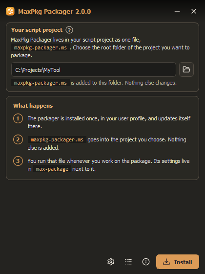
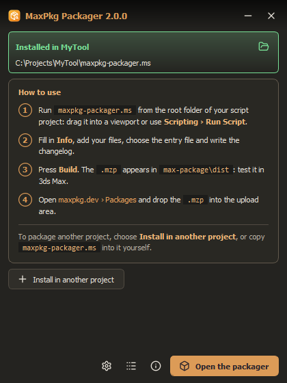
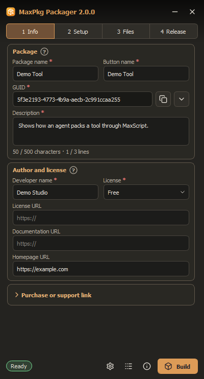
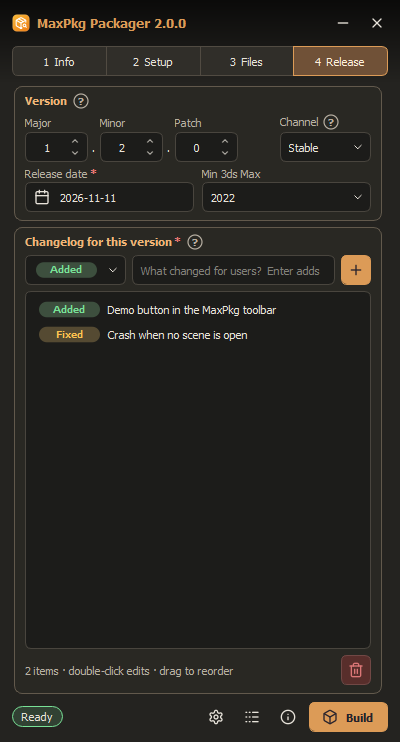
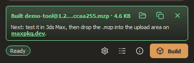

# MaxPkg Packager

Build clean `.mzp` packages of your 3ds Max scripts for [maxpkg.dev](https://maxpkg.dev).

**One file in your project.** The installer puts [`maxpkg-packager.ms`](maxpkg-packager.ms) into the root folder of
your script project; you run it in 3ds Max, fill in a few fields and press **Build**.

Requires 3ds Max 2022 or newer.

## Install

1. Download **[MaxPkgPackager.mzp](https://github.com/maxpkg-dev/max-dev-tool/releases/latest/download/MaxPkgPackager.mzp)**
   (the newest release).
2. Drag it into a 3ds Max viewport (or **Scripting > Run Script...**). It installs the packager into your user profile,
   no internet needed, and asks for the root folder of your script project.
3. It puts `maxpkg-packager.ms` there and shows how to go on. **Open the packager** starts it right away.

<p>
  
  
</p>

To package another project, run the installer again, or copy `maxpkg-packager.ms` into that project yourself.
Installing into a project that is set up already replaces only `maxpkg-packager.ms`: its `max-package` settings stay
as they are. If something goes wrong, download the installer again and run it: your projects are kept.

## Use

1. Run `maxpkg-packager.ms` from your project: drag it into a viewport or **Scripting > Run Script...**.
2. Fill in the four tabs:
   - **Info**: package name, button name, description, developer, license. The GUID is created for you.
   - **Setup**: the 3ds Max button, the toolbar, the optional install / uninstall windows.
   - **Files**: your package files, the entry file (the script the button runs) and a square SVG icon.
   - **Release**: version, channel, release date, minimum 3ds Max and the changelog.

   Fields marked with a red `*` must be filled in; the `?` next to a title explains the part.
3. Press **Build**. When something is missing, the list of problems opens; click a line to go to the field.
4. Test the `.mzp` in 3ds Max (drag it into a viewport), then upload it on
   [maxpkg.dev/dashboard/packages](https://maxpkg.dev/dashboard/packages).

<p>
  
  
</p>
<p>
  
</p>

## Your project folder

The packager adds exactly one folder next to itself:

```text
MyTool\
  maxpkg-packager.ms      the packager's launcher (the installer puts it here)
  max-package\            everything the packager keeps for this project
    project.ini           settings
    changelog.ini         changelog of every version
    icon.svg              the package icon
    _install.ms           the MaxPkg install window, in every package
    _uninstall.ms         the MaxPkg uninstall window, in every package
    dist\                 built .mzp packages
  main.ms                 your files, untouched
  ...
```

`_install.ms` and `_uninstall.ms` come with the packager: it puts them there when it opens the project and keeps
them current. For your own work at install or removal, choose a custom script on the **Setup** tab.

Projects made with the packager 1.x open as they are: their files move into `max-package` on the first run.
Commit `max-package` with your project; its `dist` is ignored automatically.

Version 1.x updates itself to 2.0: it downloads the new `maxpkg-packager.ms`, which then installs the packager and
moves the project's files. Nothing has to be done by hand.

**3ds Max 2021 and older** cannot run version 2. There the launcher and the installer offer version 1.2.1 instead
([release/maxpkg-packager-1.x.ms](release/maxpkg-packager-1.x.ms)), which stays on 1.x and does not update to 2.

## Updates

The packager checks for a new version in the background and installs it next to the current one. The new version
starts the next time you open the packager. A version that cannot start is rolled back to the previous one
automatically. You can turn automatic updates off in **Settings**.

## For AI agents and scripts

`MaxPkgPackerApi` does everything the window does, with or without the window. See
[docs/ai-agents.md](docs/ai-agents.md).

## Documentation

- [docs/ai-agents.md](docs/ai-agents.md) - automation API and workflow for AI agents.
- [docs/maxpkg-adaptation-prompt.md](docs/maxpkg-adaptation-prompt.md) - prompt to adapt an existing script to the
  MaxPkg installation flow.
- [docs/maxpkg-full-onboarding-prompt.md](docs/maxpkg-full-onboarding-prompt.md) - prompt for the complete packaging
  workflow, from adaptation to a tested `.mzp` and the marketplace listing.
- [docs/code-rules.md](docs/code-rules.md) - recommended MaxScript coding rules.

## Repository

```text
maxpkg-packager.ms     the launcher a project needs (ASCII; its header carries the version and release notes; version
                       1.x updates itself to it from here)
_install.ms            the MaxPkg install window: packed into the application and added to every package
                       (version 1.x also updates it from here)
_uninstall.ms          the MaxPkg removal window, the same way
release.bat            publishes a release (tests, build, then commit, push and GitHub release after you confirm)
maxpkg-src\            the packager: python\ (Python + Qt), assets\, tools\ (release.py, update_check.py); a name
                       no client project uses
release\               what installed copies update from: the application archive and update.json
docs\                  documentation
tests\                 tests of the packaging core and the API
```

Development: running `maxpkg-packager.ms` from the repository starts the source in `maxpkg-src\` instead of the
installed copy. Tests run with the Python of 3ds Max:

```bash
"C:\Program Files\Autodesk\3ds Max 2027\Python\python.exe" -I -m unittest discover -s tests -p "test_*.py"
```

Release (details in `.codex/how-to-release.md`): raise `__version__` in
`maxpkg-src\python\maxpkgpackager\__init__.py` and `VERSION` in `maxpkg-packager.ms` and add the version's notes to
the launcher header. Then, on `main`, double-click **`release.bat`**: it runs the tests, builds `release\` and the
installer `release\MaxPkgPackager.mzp` (also what you give a tester), shows what would be committed and, after you
answer `y`, commits, pushes and creates the GitHub release with the installer. Before publishing,
`python maxpkg-src\tools\update_check.py` rehearses the update of a 1.x user and the installer on a local server.
